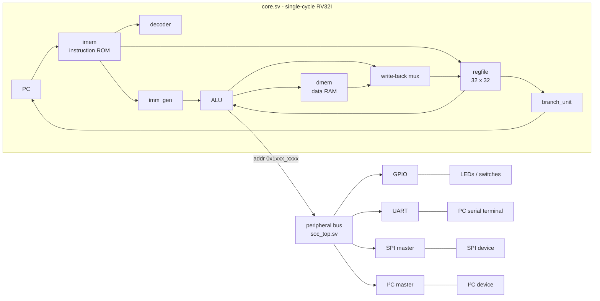

# MINI-RISCV-SOC


A small **32-bit RISC-V (RV32I) system-on-chip** written in SystemVerilog: a single-cycle CPU core,
memory-mapped **GPIO, UART, SPI and I²C** peripherals of my own design, and **C firmware** that runs on the core.

Everything is verified with self-checking Verilator testbenches (**253 checks in 20 testbenches**), including
full-system tests where compiled C code talks to behavioural SPI and I²C slaves and decodes the UART output.
FPGA build files for the Digilent Basys 3 are included but **have not been run on hardware yet**.

## Status

| Area | Status |
|---|---|
| RV32I core (single cycle) | done, simulated |
| C firmware flow (GCC to hex to memory) | done, simulated |
| GPIO, UART TX/RX, SPI master, I²C master | done, simulated |
| Board top level + Vivado script + Basys 3 constraints | written, **not tested on hardware** |

## Architecture



Each instruction (fetch, decode, execute, memory, write-back) completes in one clock cycle.

## Memory map

| Address range | What |
|---|---|
| `0x0000_0000` - `0x0000_0FFF` | RAM (4 KB: code, data, stack). The same hex image initialises instruction and data memory |
| `0x1000_0000` - `0x1000_00FF` | GPIO |
| `0x1000_0100` - `0x1000_01FF` | UART |
| `0x1000_0200` - `0x1000_02FF` | SPI master |
| `0x1000_0300` - `0x1000_03FF` | I²C master |

### Registers

**GPIO** (`0x1000_0000`)

| Offset | Name | Description |
|---|---|---|
| 0x00 | OUT | read/write, drives the 16 LED pins |
| 0x04 | IN | read only, 16 switch pins (2-flop synchronised) |

**UART** (`0x1000_0100`, 8N1, baud rate from the `BAUD` parameter)

| Offset | Name | Description |
|---|---|---|
| 0x00 | TXDATA | write a byte to send (ignored while busy) |
| 0x04 | STATUS | bit0 TX ready, bit1 RX byte available, bit2 RX overrun |
| 0x08 | RXDATA | read the received byte (reading clears bits 1 and 2 of STATUS) |

**SPI master** (`0x1000_0200`, mode 0, 8 bits, MSB first)

| Offset | Name | Description |
|---|---|---|
| 0x00 | DATA | write starts a transfer; read returns the byte received |
| 0x04 | STATUS | bit0 busy |
| 0x08 | CTRL | bit0 = CS_N level (1 = deselected) |
| 0x0C | CLKDIV | SCLK = CLK / (2 x (CLKDIV + 1)) |

**I²C master** (`0x1000_0300`)

| Offset | Name | Description |
|---|---|---|
| 0x00 | DATA | write: byte to send; read: byte received |
| 0x04 | STATUS | bit0 busy, bit1 NACK (last write not acknowledged) |
| 0x08 | CMD | bit0 START, bit1 STOP, bit2 WRITE, bit3 READ, bit4 NACK reply |
| 0x0C | CLKDIV | SCL = CLK / (4 x (CLKDIV + 1)) |

## Repository layout

```
rtl/        SystemVerilog design (core, memories, peripherals, soc_top, fpga_top)
tb/         self-checking testbenches;  tb/models/ = behavioural I2C slave
firmware/   C programs, startup code, linker script, build.sh, mmio.h drivers, .hex images
vivado/     build.tcl and basys3.xdc (not yet tested on hardware)
docs/       waveforms and notes
run_all_tests.sh   runs every testbench
```

## Running the simulations

Needs **Verilator 5**, `g++` and `make` (on Windows: MSYS2 UCRT64).

```bash
make sim TOP=core_tb          # run one testbench
sh run_all_tests.sh           # run all of them
```

Each testbench prints PASS/FAIL lines and a final `ALL n TESTS PASSED`.
The Makefile builds with `OPT_GLOBAL=-O2` because Verilator's default `-Os` build fails to link with the
MSYS2 GCC 16 toolchain.

## Building the firmware

The compiled `.hex` files are committed, so the simulations do not need a RISC-V compiler.
To rebuild a program you need `riscv64-unknown-elf-gcc` (MSYS2 package `mingw-w64-ucrt-x86_64-riscv64-unknown-elf-gcc`):

```bash
sh firmware/build.sh uart_demo     # firmware/uart_demo.c -> firmware/uart_demo.hex
```

Programs: `fib` (Fibonacci), `gpio_demo`, `uart_demo`, `uart_echo`, `spi_demo`, `i2c_demo`, `board_demo`, `monitor`.
They are compiled for `rv32i` with no standard library. `firmware/mmio.h` holds the register addresses and the
small drivers (`uart_putc`, `spi_xfer`, `i2c_write`, ...).

## FPGA (not yet tested on hardware)

`rtl/fpga_top.sv` divides the board clock for the CPU (the single-cycle core has a long logic path), holds
reset at power-up, and turns the I²C lines into real open-drain pins. `vivado/build.tcl` runs synthesis and
implementation, and `vivado/basys3.xdc` holds the pin constraints for the Digilent Basys 3 only.
`firmware/board_demo.c` prints a banner on the UART, shows a walking LED or mirrors the switches, and echoes typed
characters in upper case.

## Test summary

| Testbench | Checks | Covers |
|---|---|---|
| alu_tb | 14 | all 10 ALU operations, corner cases |
| regfile_tb | 35 | read/write ports, x0 hard-wired to 0 |
| imm_gen_tb | 13 | I/S/B/U/J immediates, negative offsets |
| decoder_tb | 21 | control signals for each instruction type |
| imem_tb / dmem_tb | 7 / 16 | instruction ROM, byte/half/word RAM access |
| branch_unit_tb | 16 | six branch conditions, signed and unsigned |
| core_tb / core_fw_tb | 9 / 12 | hand-assembled program, compiled C (Fibonacci) |
| gpio_tb / soc_tb | 7 / 9 | GPIO block, C firmware driving pins |
| uart_tb / soc_uart_tb / soc_echo_tb | 17 / 2 / 2 | UART TX and RX, printing text, echo |
| spi_tb / soc_spi_tb | 16 / 11 | SPI engine, C firmware against an SPI slave |
| i2c_tb / soc_i2c_tb | 22 / 14 | I²C engine, C firmware against an I²C slave |
| fpga_top_tb | 5 | whole board: reset, clock divider, LEDs, UART |
| soc_monitor_tb | 5 | UART monitor program: typed commands, echo, backspace, memory and LED access |

## Design notes and limitations

- RV32I only: no M/A/C extensions, no CSRs, no interrupts, no `ECALL`/`EBREAK`/`FENCE` (they decode as illegal).
- Single-cycle design: simple and easy to debug, but the clock must be slow (25 MHz planned on the Basys 3).
- Separate instruction and data memories, 4 KB each, both initialised from the same image. Only naturally aligned accesses are supported.
- UART: 8N1 only, one-byte receive buffer with an overrun flag.
- SPI: mode 0 and 8-bit transfers only; chip select is controlled by software.
- I²C: single master, no clock stretching, 7-bit addressing handled by software.
- Inputs from outside the chip (switches, UART RX, SPI MISO, I²C SDA) pass through two-flop synchronisers.

## Possible next steps

Run on hardware, interrupts and timers, M extension (multiply/divide), a pipelined core, DMA.

## Waveform: C code running on the SoC

`firmware/uart_demo.c` printing "Hello, RISC-V!" through the UART. The top rows show the program counter and the
instruction being executed; the bottom row is the UART TX pin (one character = start bit, 8 data bits, stop bit).


## Waveforms: C code running on the SoC

`firmware/uart_demo.c` printing "Hello, RISC-V!" through the UART (simulation, GTKWave).

**CPU view:** the program counter steps through the instructions the compiler produced. The three-instruction
loop at 0x30-0x38 is `while ((UART_STATUS & 1) == 0)` in `uart_putc`: the CPU waits for the UART to finish.


**UART view:** one transmitted character is a start bit (0), 8 data bits (least significant first) and a stop bit (1).


